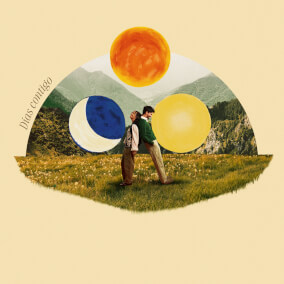

# 💍 Jhonatan & Sarai · Nuestra Boda

  

  ## ✨ Invitación Digital de Boda ✨

  
  
  
  

  

    <strong>Una invitación elegante, romántica y moderna</strong> 
    <em>Jhonatan & Sarai</em>
  

  

    <a href="#-características">✨ Características</a> •
    <a href="#-estructura-del-proyecto">📁 Estructura</a> •
    <a href="#-instalación">🚀 Instalación</a> •
    <a href="#-personalización">🎨 Personalización</a>
  

---

## ✨ Características

### 🎨 Diseño y Estilo
- **Mobile First** — Prioridad absoluta en dispositivos móviles
- **Responsive 100%** — Adaptable a todos los tamaños de pantalla
- **Paleta elegante** — Verde salvia, beige, blanco y detalles dorados
- **Tipografías premium** — Cormorant Garamond, Great Vibes y Montserrat
- **Animaciones suaves** — Fade in, slide up, scroll reveal
- **Partículas doradas y hojas** — Efectos decorativos de fondo
- **Monograma J&S** — Con coronas de laurel animadas, tamaño destacado en todos los dispositivos

### 🎵 Funcionalidades Interactivas
- **Reproductor de música flotante** — Canción "Somos" de Majo y Dan
- **Autoplay al primer gesto** — La música arranca al primer toque/clic/scroll
- **Memoria de preferencia** — Recuerda si el usuario activó/desactivó la música
- **Contador regresivo** — Cuenta atrás hasta el 22 de diciembre de 2026
- **Scroll suave** — Navegación fluida entre secciones
- **Scroll Reveal** — Animaciones al hacer scroll
- **Parallax en ramas** — Las ramas de esquina se mueven sutilmente
- **Barra de progreso de lectura** — Indicador superior

### 📋 Secciones Incluidas
1. **Portada / Hero** — Presentación de la pareja con versículo
2. **Cuenta Regresiva** — Días, horas, minutos y segundos
3. **Nuestra Historia** — Mensaje romántico con rama decorativa
4. **Ceremonia & Recepción** — Detalles y ubicaciones (Google Maps)
5. **Código de Vestimenta** — Formal / Etiqueta, con paleta reservada
6. **Confirmación (RSVP)** — Botón de WhatsApp con mensaje predefinido
7. **Pie de página** — Monograma, hashtag y créditos

### ♿ Accesibilidad
- Atributos ARIA en todos los elementos interactivos
- Navegación mediante teclado
- `prefers-reduced-motion` para usuarios con sensibilidad a animaciones
- `:focus-visible` para navegación por teclado
- Texto alternativo y `aria-label` en iconos SVG

### 🚀 Rendimiento
- Audio con `preload="auto"` (arranque rápido)
- CSS modular: `style.css`, `animations.css`, `responsive.css`
- JavaScript separado por responsabilidad
- Sin dependencias externas más allá de Google Fonts
- Soporte para notch (iPhone X+)

---

## 📁 Estructura del Proyecto
